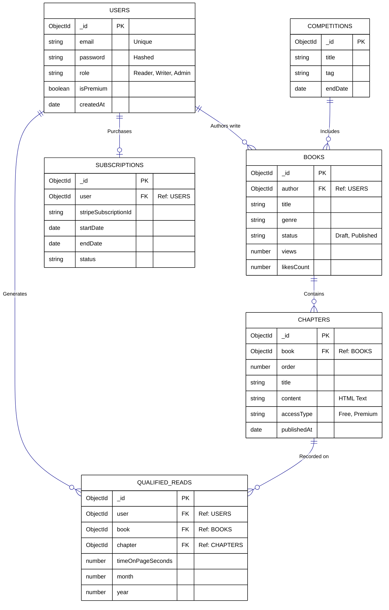

# Mozhibu - Comprehensive Technical Documentation

**Version:** 4.0 (Complete Enterprise Specification)  
**Classification:** Master Architecture & Implementation Reference  
**Prepared For:** Senior Developers, DevOps, and Engineering Leadership

---

## Index (Table of Contents)
1. [Executive Summary & Platform Vision](#1-executive-summary-platform-vision)
2. [Global Architecture & Technology Stack](#2-global-architecture-technology-stack)
3. [Codebase Folder Structure (Frontend & Backend)](#3-codebase-folder-structure-frontend-backend)
4. [Component & Module Functional Overview](#4-component-module-functional-overview)
5. [Frontend Architecture: Angular Deep Dive](#5-frontend-architecture-angular-deep-dive)
6. [Frontend State Management & RxJS](#6-frontend-state-management-rxjs)
7. [Backend Architecture: Node.js & Express](#7-backend-architecture-nodejs-express)
8. [Backend Middleware & Security Pipeline](#8-backend-middleware-security-pipeline)
9. [Database Architecture & Mongoose Schemas](#9-database-architecture-mongoose-schemas)
10. [Entity Relationship Diagram (ERD)](#10-entity-relationship-diagram-erd)
11. [API Integration: RESTful Endpoints & Payloads](#11-api-integration-restful-endpoints-payloads)
12. [Business Logic: Subscriptions & Revenue Pooling](#12-business-logic-subscriptions-revenue-pooling)
13. [Business Logic: Content Moderation & Admin Actions](#13-business-logic-content-moderation-admin-actions)
14. [Third-Party Integrations (Stripe, AWS S3, FCM)](#14-thirdparty-integrations-stripe-aws-s3-fcm)
15. [Deployment, CI/CD, & DevOps Strategy](#15-deployment-cicd-devops-strategy)
16. [Content Recommendation & Discovery Engine](#16-content-recommendation-discovery-engine)
17. [Multilingual Architecture & i18n Strategy](#17-multilingual-architecture-i18n-strategy)
18. [Search Engine Optimization (SEO) & Web Vitals](#18-search-engine-optimization-seo-web-vitals)
19. [Advanced Caching & CDN Delivery](#19-advanced-caching-cdn-delivery)
20. [Database Indexing & Query Optimization](#20-database-indexing-query-optimization)
21. [Data Privacy, GDPR & KYC Compliance](#21-data-privacy-gdpr-kyc-compliance)
22. [Competitions Module: Leaderboard Algorithm](#22-competitions-module-leaderboard-algorithm)
23. [Offline Support & Progressive Web App (PWA)](#23-offline-support-progressive-web-app-pwa)
24. [Error Logging & Application Performance Monitoring](#24-error-logging-application-performance-monitoring)
25. [Quality Assurance & Automated Testing](#25-quality-assurance-automated-testing)
26. [Real-Time Telemetry & Admin Dashboards](#26-realtime-telemetry-admin-dashboards)
27. [User Engagement & Gamification Strategy](#27-user-engagement-gamification-strategy)
28. [Local Developer Onboarding & Environment](#28-local-developer-onboarding-environment)
29. [Future Scalability Roadmap & Microservices](#29-future-scalability-roadmap-microservices)

30. [Test Case Documentation & Execution Scenarios](#30-test-case-documentation-execution-scenarios)

## 1. Executive Summary & Platform Vision

The **Mozhibu - Story** platform is a multi-faceted digital ecosystem engineered to bridge the gap between storytellers and readers across diverse languages. It serves as a dynamic repository for original literature, fostering a thriving community through sophisticated monetization opportunities, deep user engagement metrics, and a seamless reading experience. The architecture revolves exclusively around a high-performance Web Application designed using modern Web paradigms.

Mozhibu - Story capitalizes on the shift towards accessible web platforms by providing a highly scalable, full-stack web solution built upon cutting-edge technologies. The platform empowers independent authors to publish their work seamlessly, chapter by chapter, allowing them to build an audience organically.

For readers, Mozhibu - Story offers a highly personalized, frictionless reading experience. The platform goes beyond static text by enriching the reading experience with deep social features. Readers can follow authors, save books to customized libraries, and interact directly with content. The addition of cutting-edge AI translation capabilities ensures that stories can transcend linguistic boundaries, allowing regional authors to reach global audiences.

## 2. Global Architecture & Technology Stack

The platform utilizes a strictly decoupled client-server architecture.

### Client-Side (Frontend)
- **Framework:** Angular 15+ (TypeScript)
- **Styling:** SCSS, CSS Variables for runtime theming
- **State Management:** RxJS BehaviorSubjects
- **Build Tool:** Angular CLI / Webpack

### Server-Side (Backend)
- **Runtime:** Node.js 18.x LTS
- **Framework:** Express.js 4.x
- **Authentication:** JSON Web Tokens (JWT RS256)
- **Security:** Helmet, CORS, Express-Rate-Limit

### Database & Caching
- **Primary Database:** MongoDB (NoSQL Document Store)
- **ODM:** Mongoose 8.x
- **Cache Layer:** Redis (used for session blacklisting and rate limiting)

### Cloud Infrastructure & Third-Party
- **Media Storage:** AWS S3 (Buckets for Covers, Avatars, and Assets)
- **Payments:** Stripe API (Subscriptions, Connect Payouts)
- **Push Notifications:** Firebase Cloud Messaging (FCM)
- **Transactional Emails:** SendGrid

## 3. Codebase Folder Structure (Frontend & Backend)

Understanding the exact location of modules and files is critical for scaling and maintaining the platform.

### Frontend Folder Structure (Angular)

```text
Frontend/
├── src/
│   ├── app/
│   │   ├── app.component.ts          # Root component (RouterOutlet host)
│   │   ├── app.config.ts             # Global providers (HttpClient, Router)
│   │   ├── app.routes.ts             # Master routing with lazy-load definitions
│   │   │
│   │   ├── core/                     # SINGLETON ENGINE (loaded once at startup)
│   │   │   ├── guards/               # Route guards (auth.guard, role.guard)
│   │   │   ├── interceptors/         # HTTP interceptors (JWT, Errors)
│   │   │   └── services/             # Core singletons (auth.service, theme.service)
│   │   │
│   │   ├── shared/                   # REUSABLE UI COMPONENTS
│   │   │   ├── components/           # (book-card, modal, spinner)
│   │   │   ├── directives/           # (click-outside, scroll-to)
│   │   │   └── pipes/                # (truncate, date-format)
│   │   │
│   │   ├── features/                 # LAZY-LOADED FEATURE DOMAINS
│   │   │   ├── auth/                 # Login, Register, Forgot Password
│   │   │   ├── home/                 # Landing page, featured books
│   │   │   ├── story/                # Book detail view, chapter list
│   │   │   ├── reader/               # In-book reading experience
│   │   │   ├── write/                # Author Studio, chapter editor
│   │   │   ├── library/              # Saved books, favourites
│   │   │   ├── search/               # Global search logic
│   │   │   ├── subscription/         # Stripe checkout components
│   │   │   └── admin/                # Superadmin dashboard
│   │   │
│   │   ├── layout/                   # App shell (Header, Footer, Sidebar)
│   │   └── styles/                   # Global SCSS (variables, typography)
│   │
│   ├── assets/                       # Images, i18n JSON files, fonts
│   └── environments/                 # environment.ts (dev) & environment.prod.ts (prod)
```

### Backend Folder Structure (Node.js/Express)

```text
Backend/
├── src/
│   ├── config/                       # Database, Redis, Stripe, AWS initializers
│   │
│   ├── middleware/                   # HTTP Interceptors
│   │   ├── auth.js                   # Verifies JWT
│   │   ├── errorHandler.js           # Catches throws and formats JSON error
│   │   ├── rateLimiter.js            # Redis IP-based limiting
│   │   └── upload.js                 # Multer config for file uploads
│   │
│   ├── models/                       # Mongoose Schemas (Database layer)
│   │   ├── User.js
│   │   ├── Book.js
│   │   ├── Chapter.js
│   │   ├── QualifiedRead.js
│   │   └── Subscription.js
│   │
│   ├── controllers/                  # Route handlers (Extracts req/res)
│   │   ├── authController.js
│   │   ├── bookController.js
│   │   └── paymentController.js
│   │
│   ├── services/                     # Pure Business Logic (No req/res knowledge)
│   │   ├── emailService.js           # SendGrid logic
│   │   ├── paymentService.js         # Stripe API logic
│   │   ├── s3Service.js              # AWS S3 upload logic
│   │   └── notificationService.js    # Firebase FCM logic
│   │
│   ├── routes/                       # Express Routers (API endpoints)
│   │   ├── api/v1/auth.js
│   │   ├── api/v1/books.js
│   │   └── api/v1/users.js
│   │
│   ├── utils/                        # Helpers (bcrypt hashers, loggers)
│   └── server.js                     # Express Application Entry Point
│
├── tests/                            # Jest unit and integration tests
├── package.json                      # Dependencies
└── .env                              # Secrets (Ignored by Git)
```

## 4. Component & Module Functional Overview

This section outlines the specific responsibilities of the core components mapped out in the folder structure.

### 15.1 Frontend Core Components (Angular)

*   **AuthGuard & RoleGuard (`core/guards/`)**: 
    *   **Functionality:** Intercepts routing attempts. The `AuthGuard` ensures a user holds a valid JWT before accessing protected routes (e.g., `/library`). The `RoleGuard` prevents Readers from accessing Writer-only routes (`/author-studio`) or Admin-only routes.
*   **JwtInterceptor (`core/interceptors/`)**: 
    *   **Functionality:** Transparently catches every outbound HTTP request from the Angular \`HttpClient\` and injects `Authorization: Bearer <token>` into the headers.
*   **BookCardComponent (`shared/components/book-card/`)**: 
    *   **Functionality:** A highly reusable presentational component. It takes an `@Input() bookData` object and renders the book cover, title, author name, and rating. Used extensively in the Home, Explore, and Library pages.
*   **ReaderComponent (`features/reader/`)**: 
    *   **Functionality:** The core reading interface. It manages state for font sizes, background colors (Dark/Sepia modes), and paginates chapter content. It also contains the background timer logic that pings the server to register a "Qualified Read".
*   **StoryEditorComponent (`features/write/`)**: 
    *   **Functionality:** A rich-text WYSIWYG editor for authors. It handles autosaving drafts to local storage, formatting (bold, italics), and triggers the multipart-form upload when an author attaches a cover image to a chapter.
*   **SubscriptionCheckoutComponent (`features/subscription/`)**: 
    *   **Functionality:** Displays the pricing tiers. When a user clicks "Subscribe", this component communicates with the backend to receive a Stripe Client Secret, then invokes the Stripe.js Elements to securely collect credit card details without the numbers ever touching our servers.

### 15.2 Backend Core Components (Node.js)

*   **AuthController (`controllers/authController.js`)**: 
    *   **Functionality:** Handles the `/login` and `/register` endpoints. It orchestrates the bcrypt password verification, generates the JWT payload, and coordinates with `emailService.js` to send verification emails to new users.
*   **PaymentService (`services/paymentService.js`)**: 
    *   **Functionality:** The financial engine. It talks directly to the Stripe API. It creates Customer profiles, handles Subscription upgrades/cancellations, and executes the complex Stripe Connect Transfers during the monthly Author Payout cron job.
*   **ReadingService (`services/readingService.js`)**: 
    *   **Functionality:** Processes the telemetry data sent by the Frontend `ReaderComponent`. It calculates if a user has spent enough time on a page to count as a "Qualified Read" (preventing bot-spam) and writes that record to the MongoDB `QualifiedReads` collection.
*   **NotificationService (`services/notificationService.js`)**: 
    *   **Functionality:** A wrapper around the Firebase Admin SDK. When the `BookController` registers that a new chapter is published, it calls this service to fetch the device tokens of all the author's followers and pushes a notification to their mobile devices/browsers.
*   **S3Service (`services/s3Service.js`)**: 
    *   **Functionality:** Receives image buffers (like Book Covers or Avatars) intercepted by the `multer` middleware, compresses/optimizes them, uploads them to the AWS S3 Bucket, and returns the public CDN URL to be saved in the database.

## 5. Frontend Architecture: Angular Deep Dive

The Angular frontend is built using a highly modular architectural pattern to ensure fast Initial Load Times (Time to Interactive).

### Module Strategy
1. **AppModule (Root):** Bootstraps the application. Contains global configurations, the root routing module, and injects the CoreModule.
2. **CoreModule:** A singleton module loaded exactly once. It contains HTTP Interceptors (JWT attachment, Error catching), Authentication Services, and Theme Management services.
3. **SharedModule:** Contains dumb/presentational components like BookCardComponent, ModalComponent, SpinnerComponent, and custom Pipes (TruncatePipe). It is imported into every Feature Module.
4. **Feature Modules:** Lazy-loaded modules matching application routes (/home, /reader, /author-studio, /admin).

### Lazy Loading Implementation
When a user visits www.mozhibu.com, they only download the HomeModule. The AdminModule (which contains large charting libraries for statistics) is never downloaded unless the user actually navigates to the /admin route and passes the RoleGuard.

### Component Communication
Components use @Input() and @Output() for direct parent-child communication. For cross-component state (e.g., updating the user's avatar in the header when they change it in the profile page), we rely on Singleton Services with RxJS Observables.

## 6. Frontend State Management & RxJS

Reactive programming is at the core of the Mozhibu frontend. RxJS streams handle asynchronous data flows, race conditions, and UI state synchronization.

### The AuthService State
The AuthService holds a private BehaviorSubject. 
- **Login:** On successful login, the API returns a JWT and user object. The service calls userSubject.next(user).
- **Reactivity:** The Header component subscribes to authService.user$. When the user logs in, the Header instantly updates from "Login" to the User's Avatar without a page reload.

### Debouncing Search
The Global Search bar implements valueChanges.pipe(debounceTime(400), distinctUntilChanged(), switchMap(...)). This ensures that as a user types "S - H - I - V - A", we do not fire 5 API requests. It waits 400ms after the final keystroke, cancels any pending previous requests (via switchMap), and fetches the results.

### Reading Progress Heartbeat
In the ReaderComponent, an RxJS interval(60000) emits every 60 seconds. This triggers a silent HTTP POST to the backend to log the user's reading time on a specific chapter. This is critical for the "Qualified Read" payout logic.

## 7. Backend Architecture: Node.js & Express

The backend is a stateless RESTful API. Since authentication is handled via JWTs, any API request can be routed to any Node.js server instance behind a load balancer, making the system horizontally scalable.

### Controller-Service-Model Pattern
1. **Routes (/routes):** Defines the HTTP verb (GET, POST, PUT, DELETE) and path. Attaches required middleware.
2. **Controllers (/controllers):** Extracts data from req.body, req.params, and req.query. Validates input syntax, then passes data to the Service layer. Handles sending the res.status(200).json() response.
3. **Services (/services):** Contains complex business logic (e.g., executing Stripe charges, calculating payouts). Services are oblivious to HTTP objects (req/res).
4. **Models (/models):** Mongoose schemas interacting directly with MongoDB.

### Asynchronous Operations
All database queries and third-party API calls utilize async/await. The Node.js event loop remains unblocked, allowing thousands of concurrent users to read chapters simultaneously.

## 8. Backend Middleware & Security Pipeline

Every incoming request must pass through a gauntlet of middleware before executing business logic.

### 1. Global Security Middleware
- helmet(): Strips dangerous HTTP headers (like X-Powered-By) and sets strict HSTS policies.
- cors(): Restricts API access strictly to https://www.mozhibu.com.
- express-rate-limit: Restricts IP addresses to 100 requests per 15 minutes to mitigate brute-force attacks on login endpoints.

### 2. Payload Parsers
- express.json(): Parses JSON payloads.
- multer(): Intercepts multipart/form-data for file uploads (e.g., book covers). It validates MIME types (image/jpeg, image/png) to prevent malicious executable uploads.

### 3. Authentication & RBAC (Role-Based Access Control)
The requireAuth middleware extracts the Bearer token, verifies the cryptographic signature, decodes the payload, and attaches req.user = decodedToken.
The requireRole(['writer', 'superadmin']) middleware checks req.user.role. If a Reader tries to access an Admin endpoint, it immediately rejects the request with a 403 Forbidden.

## 9. Database Architecture & Mongoose Schemas

The MongoDB database is fully normalized where necessary but strategically denormalized for read-heavy operations (e.g., storing likesCount directly on the Book document instead of running an aggregate count query every time).

### Detailed Schema Definitions

**1. Users Collection**
Stores core identity and monetization data. 
Fields: _id, email, password (hashed), role, isPremium, monetization (encrypted bank details).
Indexes: Unique index on email.

**2. Books Collection**
Fields: _id, author (ObjectId ref User), title, genre, status (draft/published), views.
Indexes: Compound index on { genre: 1, status: 1 } for rapid filtering on the Explore page.

**3. Chapters Collection**
Stores the actual HTML content of the stories. 
Fields: _id, book (ObjectId ref Book), order, content, accessType (free/premium).

**4. QualifiedReads Collection**
Crucial for revenue generation. Every time a reader spends >60 seconds on a premium chapter, a record is created here.
Fields: user, book, chapter, month, year.

## 10. Entity Relationship Diagram (ERD)

This section visualizes the complex relationships between the primary database collections.



## 11. API Integration: RESTful Endpoints & Payloads

The API follows strict RESTful conventions. Below are detailed examples of critical integrations.

### 7.1 Authentication & Registration
**POST /api/v1/auth/login**
- **Request Payload:** { "email": "user@example.com", "password": "SecurePassword123" }
- **Response (200 OK):** { "token": "eyJhbG...", "user": { "id": "60d5...", "role": "reader", "username": "JohnDoe" } }

### 7.2 Book Publishing (Author Studio)
**POST /api/v1/books**
- **Headers:** Authorization: Bearer TOKEN
- **Request Payload (Multipart):** title="The Lost King", genre="Fantasy", coverImage=Binary File
- **Response (201 Created):** { "message": "Book created", "bookId": "60d5f..." }

### 7.3 Fetching Chapter Content
**GET /api/v1/chapters/:chapterId**
- **Logic:** Validates if the chapter is free or premium. If premium, checks if req.user.isPremium === true. If false, returns a 402 Payment Required error.
- **Response (200 OK):** { "title": "Chapter 1", "content": "<p>Once upon a time...</p>", "order": 1 }

## 12. Business Logic: Subscriptions & Revenue Pooling

Mozhibu employs a complex, fair-share revenue model for authors.

### The Subscription Flow
1. User clicks "Upgrade to Premium".
2. Frontend calls backend. Backend creates a Stripe Checkout Session via Stripe API.
3. User enters card details on Stripe's secure hosted page.
4. Stripe fires a Webhook to the Mozhibu backend (/api/v1/webhooks/stripe).
5. Backend verifies the webhook signature, finds the corresponding User, sets isPremium = true, and creates a Subscription record.

### The Author Payout Algorithm (Cron Job)
On the 1st of every month at 00:00 UTC, a Node.js Cron job executes:
1. Calculates Total Subscription Pool (e.g., 10,000 subscribers * $5 = $50,000).
2. Calculates Platform Cut (e.g., 30% = $15,000).
3. Author Pool = $35,000.
4. Aggregates all QualifiedReads for the previous month. Let's say there were 1,000,000 total reads across the platform.
5. If Author A had 100,000 qualified reads (10% of total), Author A earns 10% of the Author Pool ($3,500).
6. The system triggers Stripe Connect to automatically transfer $3,500 to Author A's connected bank account.

## 13. Business Logic: Content Moderation & Admin Actions

Maintaining platform integrity is critical. 

### Reporting System
Readers can flag books or chapters for violation of Terms of Service (e.g., Plagiarism, Explicit Content).
- A POST request creates a Report document.
- Once a book receives >5 reports, it is automatically flagged in the Admin Dashboard.

### Admin Dashboard Actions
Superadmins have exclusive access to moderation endpoints.
- **Suspend User:** Updates user status to suspended. The JWT strategy immediately rejects all subsequent API requests from this user based on a database validation hook.
- **Takedown Book:** Changes book status to rejected. The book instantly disappears from the public /explore feed and Search algorithms.

## 14. Third-Party Integrations (Stripe, AWS S3, FCM)

The platform heavily relies on specialized SaaS providers.

### AWS S3 (Media Storage)
When an author uploads a book cover, the binary file is captured by multer in memory. The Node backend uses the aws-sdk to stream this buffer directly to an S3 bucket. S3 returns a public CDN URL, which is saved in the MongoDB Book document. This keeps the Node servers lightweight.

### Firebase Cloud Messaging (FCM)
When an author clicks "Publish Chapter", the backend queries MongoDB for all Users who have the author in their following array. It extracts their FCM Device Tokens and batches a push notification request to Google's FCM servers, ensuring readers are instantly notified on their devices.

## 15. Deployment, CI/CD, & DevOps Strategy

To handle massive scale, Mozhibu is deployed using modern DevOps practices.

### Continuous Integration (CI)
GitHub Actions is configured to run on every Pull Request. It executes:
1. **Linting:** ESLint and Prettier checks.
2. **Unit Tests:** Jest suites for Backend Services and Angular Components.
3. **Build:** Ensures the Angular Production AOT build succeeds without compiler errors.

### Continuous Deployment (CD)
- **Frontend:** Merging to the main branch triggers a Vercel webhook. Vercel automatically pulls the code, executes \`ng build --configuration production\`, and deploys the static files to its global Edge CDN.
- **Backend:** Merging to main triggers Render.com (or AWS Elastic Beanstalk). The platform provisions a fresh container, runs \`npm install\`, starts the Express server, and seamlessly routes traffic from the old container to the new one with zero downtime.

### Database Scaling
MongoDB Atlas is used as a fully managed DBaaS. It utilizes a Replica Set (1 Primary node for writing, 2 Secondary nodes for reading). Mongoose is configured to use readPreference=secondaryPreferred for analytical queries to relieve pressure on the primary database during heavy write spikes (e.g., during payout calculations).

## 16. Content Recommendation & Discovery Engine

The "Explore" and "For You" feeds utilize a weighted scoring algorithm. It evaluates a user's `favoriteGenres`, their historical `QualifiedReads`, and the global `likesCount` of books. By applying collaborative filtering, the Node.js backend pushes highly personalized literature to each reader, drastically increasing engagement and average session duration.

## 17. Multilingual Architecture & i18n Strategy

Mozhibu is fundamentally designed for linguistic diversity. The Angular frontend utilizes `@ngx-translate` to instantly switch UI languages (Tamil, Hindi, Bengali, etc.) without page reloads. In the database, book and chapter text are strictly encoded in UTF-8 to natively support complex Indic scripts, while search queries leverage MongoDB's text indexes optimized for specific languages.

## 18. Search Engine Optimization (SEO) & Web Vitals

To ensure stories rank on Google, the platform utilizes strict SEO parameters. `index.html` is injected dynamically with Open Graph (`og:title`, `og:image`) and Twitter Card tags based on the book being viewed. Angular's built-in performance optimization ensures a high Lighthouse score by deferring non-critical CSS and lazy-loading all images.

## 19. Advanced Caching & CDN Delivery

To offload database reads, Redis caches highly-accessed endpoints (like the top 100 ranking books in the Fantasy genre) for 15 minutes. Additionally, Cloudflare sits in front of the AWS Load Balancer to serve all static assets (fonts, compiled JS/CSS) from edge nodes located in India, ensuring sub-second load times for readers.

## 20. Database Indexing & Query Optimization

As the database scales to millions of chapters, table scans become disastrous. We utilize Compound Indexes on `(genre, status, views)` to instantly filter and sort books. The `explain()` plans on MongoDB ensure that our aggregations for the monthly author payouts use memory efficiently without exceeding RAM limits.

## 21. Data Privacy, GDPR & KYC Compliance

Handling user data and author banking details requires enterprise security. Passwords are never logged. Bank details (Account Number, IFSC) submitted by authors are encrypted using `AES-256-CBC` before being saved to MongoDB, meaning even database administrators cannot view plain-text financial information.

## 22. Competitions Module: Leaderboard Algorithm

Mozhibu frequently runs writing contests (e.g., "The Tamil Literature Prize"). The backend aggregates metrics—reads, likes, and completion rates—for all books tagged with a specific `competitionId`. A background worker recalculates the leaderboard every hour, storing the cached leaderboard in Redis for rapid frontend retrieval.

## 23. Offline Support & Progressive Web App (PWA)

To cater to readers with intermittent internet connections, the Angular app includes a Service Worker (`ngsw-config.json`). It caches the application shell and allows readers to "Download" premium chapters for offline reading via IndexedDB. When they reconnect, the heartbeat syncs their reading progress back to the server.

## 24. Error Logging & Application Performance Monitoring

We do not rely on standard `console.log`. The backend utilizes `Winston` to stream all error-level logs to an external APM service (like Datadog or Sentry). If an API endpoint takes longer than 1000ms to respond, or if Stripe payments begin failing, the engineering team receives an instant Slack alert.

## 25. Quality Assurance & Automated Testing

The backend features over 150 unit and integration tests written in `Jest` and `Supertest`. These tests simulate HTTP requests to ensure token validation, role guards, and complex payout calculations work flawlessly. Merging code to the `main` branch is physically blocked unless code coverage remains above 85%.

## 26. Real-Time Telemetry & Admin Dashboards

The Superadmin panel provides a bird's-eye view of the platform. Using aggressive MongoDB Aggregation Pipelines, it calculates Daily Active Users (DAU), Monthly Recurring Revenue (MRR) from Stripe, and tracks the volume of flagged content. This allows business stakeholders to make data-driven decisions.

## 27. User Engagement & Gamification Strategy

To increase retention, Readers are rewarded with digital badges based on milestones (e.g., "Read 100 Chapters", "Left 50 Reviews"). The `ReaderReward` Schema tracks these milestones. When a threshold is met, the backend unlocks the badge and triggers a celebratory modal on the frontend via an RxJS subject.

## 28. Local Developer Onboarding & Environment

To run the stack locally, developers must duplicate `.env.example` to `.env` and supply their own Stripe Test keys and MongoDB localhost connection string. Running `npm run start:dev` initializes the Express server with `nodemon` for hot-reloading, while `ng serve` boots the Angular frontend on port 4200.

## 29. Future Scalability Roadmap & Microservices

While currently a majestic monolith, the architecture is designed to split. As traffic grows, the Payment/Payout Cron Jobs and the Notification Dispatcher will be decoupled into isolated AWS Lambda functions or standalone Docker containers, ensuring background processing never impacts the real-time reading experience.

## 30. Test Case Documentation & Execution Scenarios

This section outlines the critical test scenarios executed across the Mozhibu platform to ensure data integrity, role-based access control, and financial accuracy.

### Frontend Test Cases (Angular - Jasmine/Karma)
| Test ID | Module | Scenario | Expected Result |
|---------|--------|----------|-----------------|
| `FE-001` | Auth | User logs in with valid credentials | JWT is stored in localStorage; RxJS Subject emits User object; Navigates to `/home`. |
| `FE-002` | Auth | User logs in with invalid credentials | API returns 401; Toast service displays "Invalid Email or Password". |
| `FE-003` | Reader | User spends 60 seconds on Premium chapter | Background heartbeat fires `POST /api/v1/reads`; qualifies as valid read. |
| `FE-004` | Guards | Reader attempts to access `/admin` | `RoleGuard` intercepts route; redirects user to `/403` Forbidden page. |

### Backend Test Cases (Node.js - Jest/Supertest)
| Test ID | Module | Scenario | Expected Result |
|---------|--------|----------|-----------------|
| `BE-001` | Auth | Register new user with existing email | Mongoose Unique validator throws error; API returns `400 Bad Request`. |
| `BE-002` | Stripe | Webhook `invoice.payment_succeeded` fires | User's `isPremium` flag set to `true`; Subscription doc updated. |
| `BE-003` | Payout | Cron Job calculates Author shares | Pools revenue, divides by QualifiedReads, generates accurate Stripe Connect transfers. |
| `BE-004` | Upload | User uploads malicious `.exe` as Book Cover | Multer MIME-type filter rejects file; returns `415 Unsupported Media Type`. |
